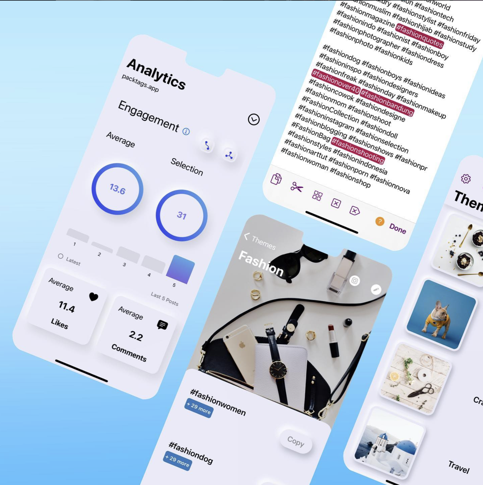
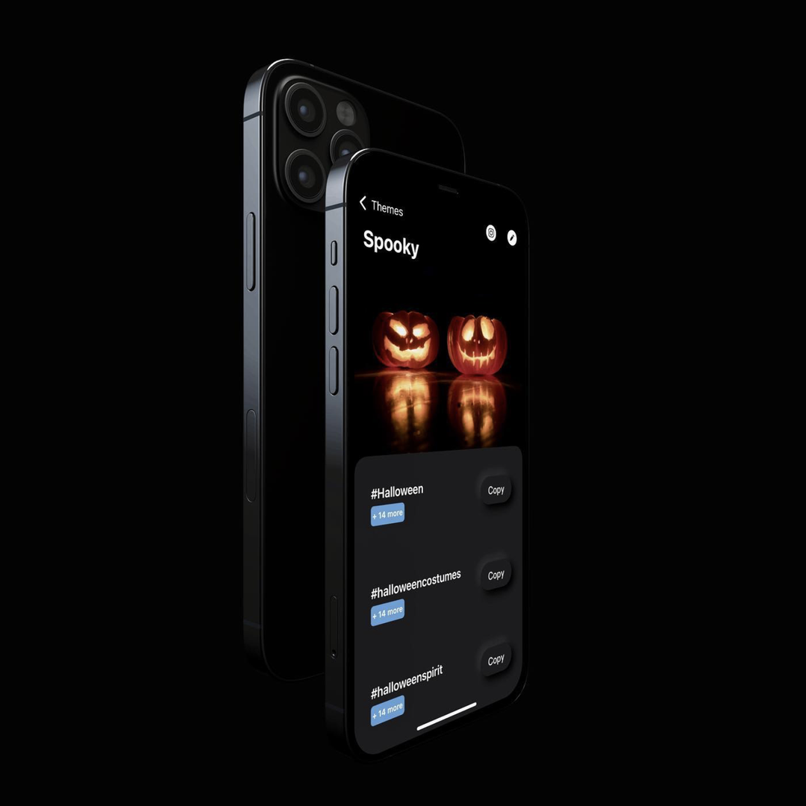
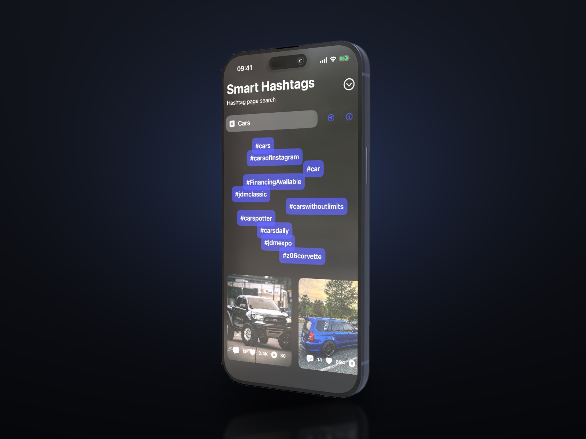
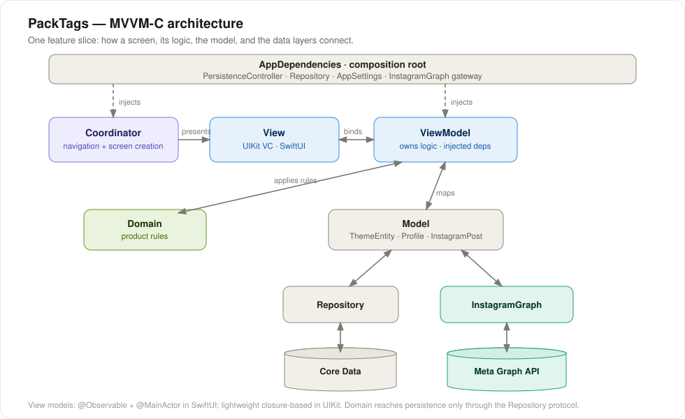
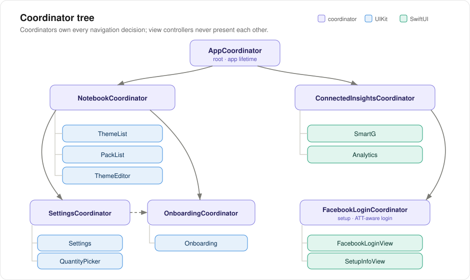

# PackTags

**The notebook for Instagram hashtags. [Shipped on the App Store](https://apps.apple.com/app/id1579377025).**

[](https://github.com/A-bv/PackTags/actions/workflows/ci.yml)


Save hashtags as reusable themed packs, copy a pack in one tap, and lift tags straight out of a screenshot. Connect an Instagram Business account through the official Meta Graph API and PackTags also finds live hashtags for any topic and reports how your recent posts performed.

<p align="center">
  
  
  
  
</p>

## Engineering

The highlights are below; the full breakdown — every concurrency, testing, observability, and platform-API technique — is in **[docs/ENGINEERING.md](docs/ENGINEERING.md)**.

- Swift 6 language mode with `SWIFT_STRICT_CONCURRENCY = complete`: the whole target compiles under full data-race checking, not the opt-in minimal mode.
- Structured concurrency with real cancellation: a custom `withThrowingTimeout` that races work against `Task.sleep` in a task group and cancels the loser, plus generation-token guards that discard superseded searches.
- Protocol-driven DI from a single composition root: no app singletons; every dependency arrives through `init`, so every unit test runs against fakes.
- Modular by extraction: networking, tag editing, and the reusable UI live in five first-party Swift packages ([`InstagramGraph`](https://github.com/A-bv/InstagramGraph), [`TapTagKit`](https://github.com/A-bv/TapTagKit), [`TableViewControllerCoverKit`](https://github.com/A-bv/TableViewControllerCoverKit), [`NeumorphicUIKit`](https://github.com/A-bv/NeumorphicUIKit), [`NeumorphicSwiftUI`](https://github.com/A-bv/NeumorphicSwiftUI)) maintained separately from the app.
- Accessibility and performance as CI gates: automated `performAccessibilityAudit()` UI tests and a cold-launch `XCTApplicationLaunchMetric` baseline that gates regressions.

## Architecture

MVVM-C (Model, View, ViewModel, Coordinator) over a Domain / Repository core, wired by one composition root. Two data sources share one shape: local data flows through repositories over Core Data; remote data is decoded into value models by the `InstagramGraph` package behind an `async` gateway, so the app target contains no networking code of its own.

<p align="center">
  
</p>

<p align="center">
  
</p>

The conventions the codebase holds to (layering, DI, naming, who presents what) are documented in **[docs/CONVENTIONS.md](docs/CONVENTIONS.md)**.

> **Worked example.** Diagnosing why analytics silently broke after a Facebook SDK upgrade (the classic Graph token's validity became coupled to App Tracking Transparency) is written up as an ADR, with the on-device test matrix and the alternatives weighed: **[docs/CONNECTED_INSIGHTS_ATT.md](docs/CONNECTED_INSIGHTS_ATT.md)**.

## Build & run

Requires Xcode 16 or later (for the Swift 6 language mode) and the iOS 17 SDK.

```sh
git clone https://github.com/A-bv/PackTags.git
cd PackTags
cp Secrets.xcconfig.template Secrets.xcconfig   # placeholder is enough to build
open PackTags.xcodeproj                          # SPM resolves packages on open
```

Run the **PackTags** scheme on any iOS 17+ simulator. The notebook works offline out of the box; the connected features additionally need real Facebook credentials in `Secrets.xcconfig` and an Instagram Business account, which the app walks you through linking.

```sh
# tests — any iOS 17+ simulator works; swap the name below for one you have
xcodebuild test -scheme PackTags \
  -destination 'platform=iOS Simulator,name=iPhone 17 Pro'
```

## Author

Built and maintained by [A-bv](https://github.com/A-bv).

## License

A personal, closed-source app. The source is public for portfolio review and is not licensed for reuse.
