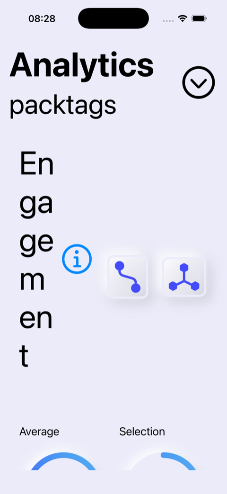
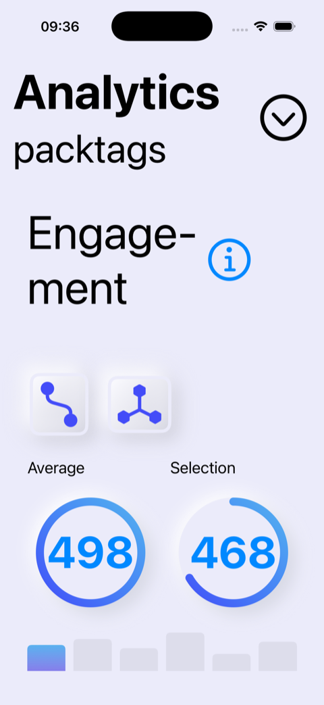
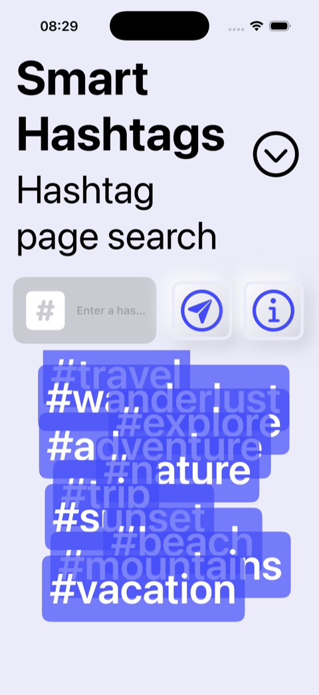
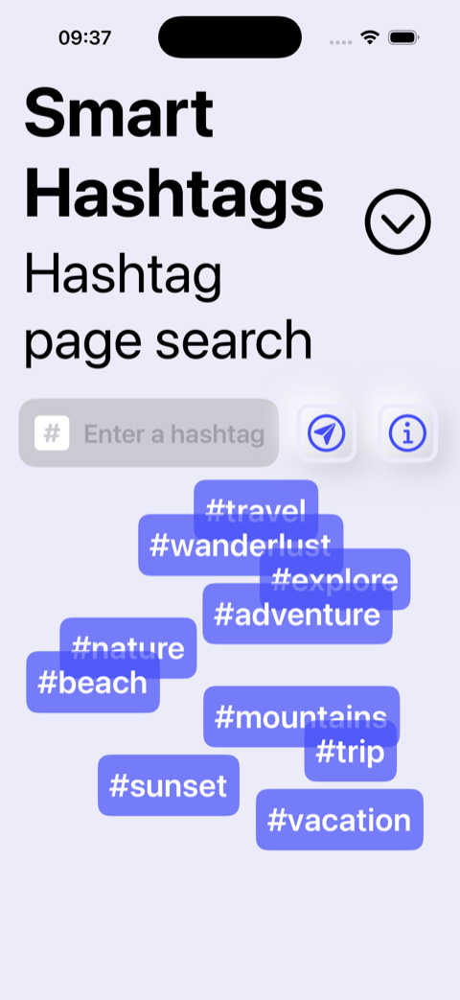

# Accessibility: Dynamic Type on the connected screens

The Analytics and Smart Hashtags screens use custom, fixed-geometry layouts that
broke at the largest accessibility text sizes. This pass makes them adapt. Each
capture below is taken at the maximum accessibility text size (AX5).

## Analytics

The metric title wrapped one letter per line and the gauges were pushed off
screen. The header now stacks above its controls at accessibility sizes, so the
title keeps full width and hyphenates, and the gauges stay visible.

| Before | After |
| --- | --- |
|  |  |

## Smart Hashtags

The search placeholder clipped to "Enter a has..." and the tag cloud piled into
an unreadable mass. The field now fills its row with the control bar capped to a
readable size, and the tag cloud's text size is bounded so the tags stay legible.

| Before | After |
| --- | --- |
|  |  |
